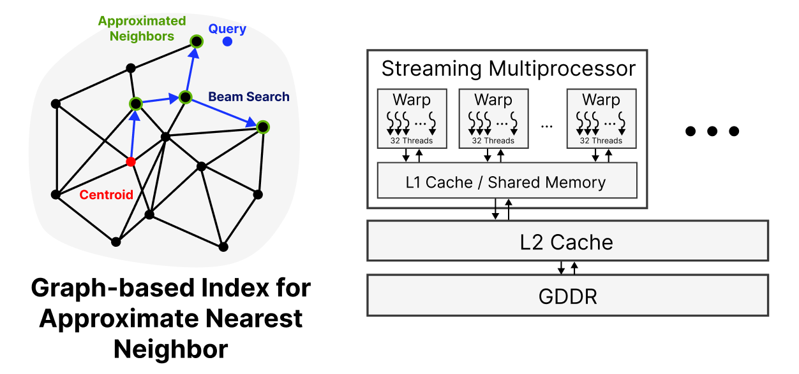

Approximate nearest neighbor search (ANNS) finds the vectors closest to a query in high-dimensional space, and it underpins recommendation, image retrieval, anomaly detection, and retrieval-augmented generation (RAG) for large language models. Graph-based indices such as Vamana offer the best recall–throughput trade-off, and GPUs are a natural fit: their massive parallelism can serve millions of queries per second.

<figure class="not-prose my-6 mx-auto max-w-md">
  
  <figcaption class="text-center text-sm text-gray-500 mt-2">GPUs bring orders-of-magnitude faster construction and query times for ANN search, <b>but only when the data fits in device memory</b>.</figcaption>
</figure>

In this project, we built a library providing an updatable index for approximate nearest neighbor search on GPU. Our goal is to efficiently scale its construction and querying beyond GPU memory, handling vector search at billion scale.

## Publication

<table class="w-full text-left border-collapse text-sm not-prose">
  <tbody class="text-gray-900">
    <tr class="border-t border-b border-gray-200">
      <td class="py-3 pr-4">
        <a href="https://arxiv.org/abs/2601.07048" class="text-indigo-600">GPU-Accelerated ANNS: Quantized for Speed, Built for Change</a>
      </td>
      <td class="py-3 pr-4">Hunter McCoy, <b>Zikun Wang</b>, Prashant Pandey</td>
      <td class="py-3 pr-4">VLDB 2026</td>
    </tr>
  </tbody>
</table>
