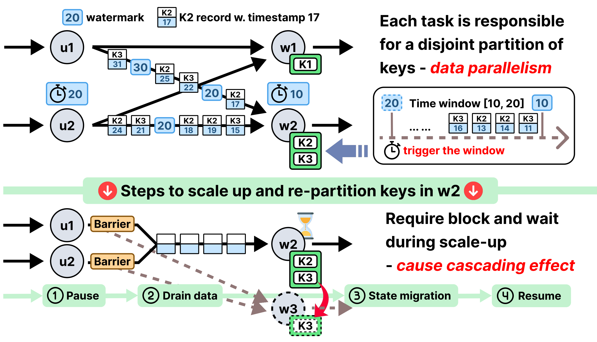

Data stream processing applications are long-running and deployed as a dataflow of operator tasks spread across physical workers. Two challenges make them hard to run efficiently:

**Policy: Choosing a good configuration is hard.** Operators have diverse resource requirements, and co-locating tasks that compete for the same resource — CPU, disk I/O, or network — creates contention that cripples throughput. The search space is enormous (millions of candidate plans for even a handful of operators on a few workers), and existing approaches fall short: random placement (e.g., Flink's default) often lands on poor plans, while ILP-based methods are too slow for online use and hard to extend with richer objectives.

<figure class="not-prose my-6 mx-auto max-w-md">
  
  <figcaption class="text-center text-sm text-gray-500 mt-2">Runtime reconfiguration of a streaming dataflow causes downtime due to state migration overhead.</figcaption>
</figure>

**Mechanism: Changing the configuration at runtime is disruptive.** Workloads are dynamic and unpredictable, so any initial configuration eventually drifts out of tune — input rates spike, data skews, or a host becomes unavailable — forcing frequent reconfiguration. Yet today's mechanisms all stall the pipeline to do it: stop-and-restart pauses execution to drain in-flight data, and stateful rescaling blocks to flush and migrate operator state (which can be many gigabytes). The result is system downtime precisely when the system most needs to adapt.

This project addresses both the policy and the mechanism. For the placement **policy**, see the CAPSys [publication](#publication) and the [task-placement poster](/posters/placement.pdf) below. For the zero-downtime reconfiguration **mechanism**, see the [reconfiguration poster](/posters/reconfiguration.pdf); the [workload-scaling poster](/posters/UROP.pdf) covers the scaling policy that drives it.

## Publication

<table class="w-full text-left border-collapse text-sm not-prose">
  <tbody class="text-gray-900">
    <tr class="border-t border-b border-gray-200">
      <td class="py-3 pr-4">
        <a href="https://dl.acm.org/doi/10.1145/3689031.3696085" class="text-indigo-600">CAPSys: Contention-aware task placement for data stream processing</a>
      </td>
      <td class="py-3 pr-4">Yuanli Wang, Lei Huang, <b>Zikun Wang</b>, Vasiliki Kalavri, Ibrahim Matta</td>
      <td class="py-3 pr-4">EuroSys 2025</td>
    </tr>
  </tbody>
</table>

## Posters

<table class="w-full text-left border-collapse text-sm not-prose">
  <tbody class="text-gray-900">
    <tr class="border-t border-b border-gray-200">
      <td class="py-3 pr-4">
        <a aria-label="Open PDF file" href="/posters/reconfiguration.pdf" class="text-indigo-600">Zero-downtime reconfiguration mechanisms for dynamic data stream processing</a>
      </td>
      <td class="py-3 pr-4"><a href="https://nedbday.github.io/2025/" class="italic">North East Database Day 2025</a></td>
      <td class="py-3 pr-4">Jan 9, 2025</td>
    </tr>
    <tr class="border-t border-b border-gray-200">
      <td class="py-3 pr-4">
        <a aria-label="Open PDF file" href="/posters/UROP.pdf" class="text-indigo-600">Effective Workload Scaling in Streaming System</a>
      </td>
      <td class="py-3 pr-4"><a href="https://www.bu.edu/urop/symposium/" class="italic">The 27th Annual Undergraduate Research Symposium at Boston University</a></td>
      <td class="py-3 pr-4">Oct 18, 2024</td>
    </tr>
    <tr class="border-b border-gray-200">
      <td class="py-3 pr-4">
        <a aria-label="Open PDF file" href="/posters/placement.pdf" class="text-indigo-600">Automatic Task Placement Decisions for High-throughput and Resource-efficient Data Stream Processing</a>
      </td>
      <td class="py-3 pr-4"><a href="https://bu-disc.github.io/nedbday/2024/" class="italic">North East Database Day 2024</a></td>
      <td class="py-3 pr-4">May 23, 2024</td>
    </tr>
  </tbody>
</table>
